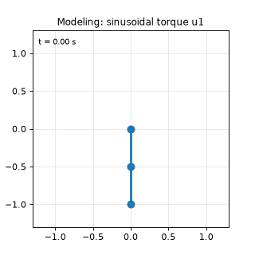
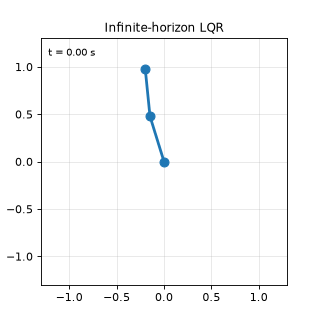
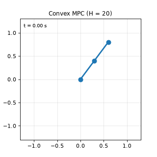

# Double-Pendulum-Control
This repository contains the implementation of a **Linear Quadratic Regulator (LQR)** and **Convex Model Predictive Control (MPC)** for stabilizing a **double pendulum system** around its upright (unstable) equilibrium. The [project](https://github.com/ChouliarasVasileios/Double-Pendulum-Control/blob/main/ECEUoP_RS_2_HW_2.pdf) was developed as part of the **Robotic Systems II** course at the **Department of Electrical and Computer Engineering, University of Patras**, supervised by **Assistant Professor Konstantinos Chatzilygeroudis**.

## Demo

| Modeling (open loop) | Infinite-horizon LQR | Convex MPC (H = 20) |
|:---:|:---:|:---:|
|  |  |  |
| Sinusoidal torque on joint 1 (A = 4.5, f = 1 Hz), RK4 with dt = 0.01 s | Starts perturbed at [π+0.3, −0.2, 0, 0]ᵀ and is stabilized at x̄ = [π, 0, 0, 0]ᵀ, dt = 0.05 s, \|u\| ≤ 10 | Starts at q1 = 2.5 rad and is driven towards x̄, dt = 0.05 s, \|u\| ≤ 10 |

## Project Overview
The aim of this assignment was to:

- Formulate the **dynamics of the double pendulum** and discretize them with **4th-order Runge–Kutta**.
- **Linearize** the non-linear discrete dynamics around the fixed point x̄ = [π, 0, 0, 0]ᵀ, ū = [0, 0]ᵀ using automatic differentiation (JAX).
- Apply **linear control techniques (infinite-horizon LQR and convex MPC)** to the **non-linear system**, always simulating with the true non-linear dynamics.
- Demonstrate how **linear approximations** can control a complex system, and where they stop working.

The double pendulum is a classic example of a non-linear system known for its chaotic behavior. By applying linear control methods, this project shows how such a system can still be approximated and controlled within certain operating regions.

## Repository Structure

| File | Description |
|---|---|
| `Modeling.py` | Double pendulum dynamics (M, C, G matrices), RK4 discretization and matplotlib visualization |
| `Linearization_and_LQR.py` | Linearization with `jax.jacobian`, Riccati recursion for the infinite LQR gains and closed-loop rollout |
| `Controling_via_convex_MPC.py` | Convex MPC formulated as a QP and solved at each step with [ProxSuite](https://github.com/Simple-Robotics/proxsuite) |

## Installation

```bash
git clone https://github.com/ChouliarasVasileios/Double-Pendulum-Control.git
cd Double-Pendulum-Control
python3 -m venv .venv
source .venv/bin/activate
pip install -r requirements.txt
```

## Usage

```bash
python Modeling.py                     # Part 1: open-loop simulation + plots
python Linearization_and_LQR.py        # Part 2: infinite LQR
python Controling_via_convex_MPC.py    # Part 3: convex MPC
```

## Report

A detailed technical report ([Homework2_Robotics_System_II.pdf](https://github.com/ChouliarasVasileios/Double-Pendulum-Control/blob/main/Homework2_Robotics_System_II.pdf)) is provided in Greek, documenting:

- The mathematical modeling
- Linearization & LQR
- Convex MPC
- Simulation results

## Acknowledgements
This project was completed as part of the Robotic Systems II course at the University of Patras under the guidance of **Assistant Professor Konstantinos Chatzilygeroudis**.
